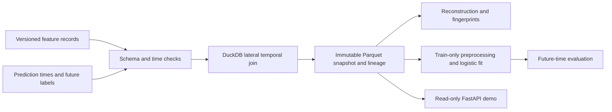

# FeatureLedger

A local point-in-time ML data pipeline with versioned feature records, immutable Parquet snapshots, row-level lineage and reproducible logistic-model evaluation.

**Generate fictional events → validate → point-in-time join → snapshot → reconstruct → train → compare safe and leaky datasets.**

## Run (Windows, Python 3.11)

```powershell
cd "D:\AI-Projects\outputs\FeatureLedger"
$env:OPENBLAS_NUM_THREADS="2"
$env:OMP_NUM_THREADS="2"
py -3.11 -m venv .venv
.\.venv\Scripts\python.exe -m pip install -r requirements-lock.txt
.\.venv\Scripts\python.exe -B -m unittest discover -s tests -v
.\.venv\Scripts\python.exe -B pipeline.py
.\.venv\Scripts\python.exe -B check_api.py
.\.venv\Scripts\python.exe -B -m uvicorn app:app --host 127.0.0.1 --port 8527
```

Open http://127.0.0.1:8527. Inspect both join modes, original event time, availability time, revision, selected value and snapshot ID. Click **Reconstruct snapshot** to verify the saved source records and rebuild matching logical rows. /docs provides the read-only API. No Docker, GPU, paid provider or API key is required.

## Data and time contract

All records are original seeded synthetic subscription-risk examples: 160 fictional accounts, 16 weekly predictions, two numerical features. They are not real customers, transactions, a public forecast benchmark or evidence of business accuracy. No external dataset or demographic features are used.

`events.json` contains `event_id`, `entity_id`, `feature`, `revision`, `event_time`, `available_at`, `value`. Revisions share an event's identity/effective time and must have increasing availability. `available_at` means first usable arrival in the operational system, **not** a retrospectively assigned source timestamp. UTC ISO timestamps are canonicalized and checked. Records with duplicate revisions, conflicting identities, invalid times or nonfinite values fail validation. Production ingestion would need independently enforced arrival timestamps; this local demo trusts its supplied records.

`observations.json` contains an ID, entity, `prediction_at`, binary label and `label_available_at`. Future labels are kept separate from model features. A training row is eligible only when its prediction precedes the training cutoff and its label is already available. Snapshots contain only labels available by their as-of cutoff; label-bearing datasets are retrospective training artifacts, not online inference payloads.

The safe join filters feature records by **event_time <= prediction_at AND available_at <= prediction_at AND available_at <= snapshot_as_of** before selecting the latest event time/revision. Late corrections cannot hide an earlier usable revision. Missing values remain explicit. Medians, scaling and missingness-aware logistic weights are fitted only on eligible training rows.

The `event_only` comparison intentionally omits the prediction-time availability filter. The generator deliberately makes one correction strongly encode the subsequent label, available five days after prediction. Any resulting score increase is engineered leakage, not a better deployable model. Do not use it as a portfolio accuracy claim.

## Snapshots and reconstruction

Snapshot IDs hash the builder version and source hash, DuckDB version, SQL hash, selected source fingerprints, features, mode and as-of cutoff. Each immutable directory contains the canonical selected source JSON, explicit-schema Parquet and manifest. Row lineage includes the chosen event ID and revision. The manifest stores both artifact SHA-256 values and a canonical logical-row SHA-256.

Existing snapshots are verified and reused, never silently overwritten. A later-available append is excluded from an earlier cutoff and leaves that snapshot unchanged. Existing snapshots retain their own source copies, so reconstruction does not depend on the latest mutable source. A new earlier-available/backdated input changes source identity and produces a different snapshot; this tool does not prove the truth of supplied timestamps. Changing the builder or DuckDB version changes identity rather than pretending to reconstruct the old environment.

```powershell
.\.venv\Scripts\python.exe -B snapshot.py --as-of "2025-05-15T00:00:00+00:00"
.\.venv\Scripts\python.exe -B snapshot.py --reconstruct YOUR_FULL_64_CHARACTER_SNAPSHOT_ID
```

Parquet byte checksums detect modifications to a saved artifact. Reconstruction compares logical content, not cross-version byte-identical Parquet. Hashes and local manifests are unsigned and mutable by the file owner; they are not authentication, tamper-proof storage or external provenance attestation. This is a local batch JSON-to-Parquet prototype, not a distributed feature store or production ingestion service.

## Evaluation

Run pipeline.py to generate data and train the same fixed 600-step NumPy logistic model separately on the safe and intentionally leaky snapshots. Models are actual fitted weights saved under private/, not mocked predictions. Cutoff: 2025-03-14 UTC; snapshot: 2025-05-15 UTC. Report future prediction rows separately. Rows whose labels are not available by the training cutoff are excluded. The same fictional accounts recur over time; results are not unseen-account generalization. There is no tuning on test outcomes. Fixed synthetic data and test scenarios intentionally exercise known failure modes; passing them does not establish general leakage prevention.

Actual measured metrics, majority-class baseline, missingness, violation counts, source fingerprints, training setup, reconstruction outcomes and environment are saved in reports/evaluation.json and reports/RESULTS.md. Tests exercise delayed revisions, newer unavailable events, future/cross-entity isolation, availability boundaries, missingness, late labels, source order, append stability, artifact tampering and train-only preprocessing. API checks use saved snapshots through in-process HTTP; browser layout and concurrent production traffic are not measured.

The API loads evaluated artifacts at startup and fails if code hashes no longer match its report. Bind to localhost only. Re-run pipeline.py and restart the server after code or dataset changes. No user authentication or remote deployment is included. Keep private/ and .venv/ out of Git; aggregate reports contain only fictional IDs/fingerprints and may be published. Publication instructions belong outside the repository.

## Architecture



Code and original synthetic generator: MIT (LICENSE). DuckDB is used for SQL execution and Parquet export: https://duckdb.org/docs/ . NumPy performs numerical model fitting; FastAPI serves the local demo.
